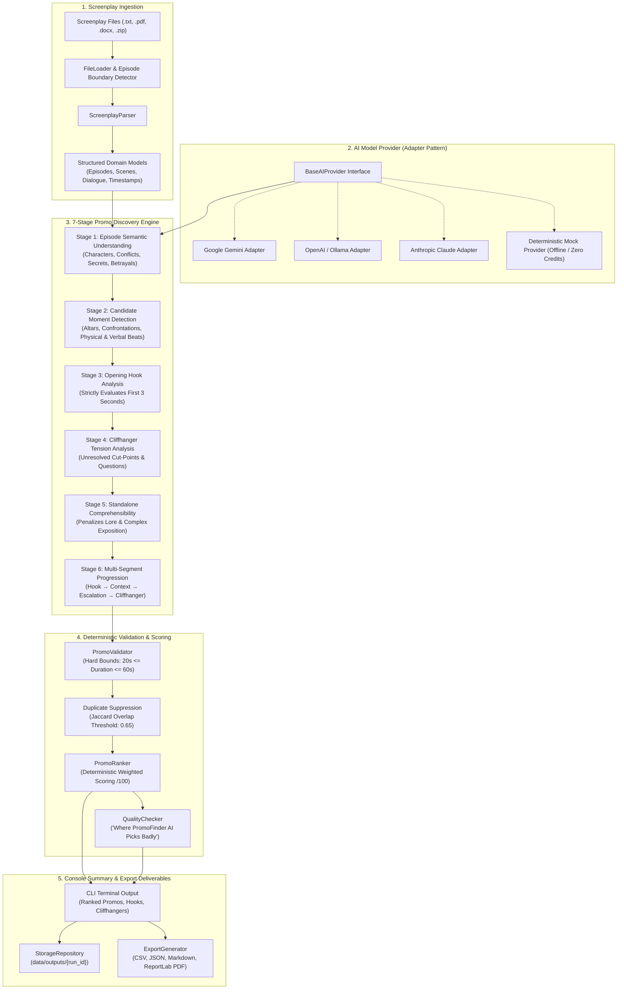

# PromoFinder AI
> **"Discover the moments that make viewers stop, watch, and come back for more."**

*A pure Python promotional discovery and ranking engine for vertical microdramas (TikTok, Instagram Reels, YouTube Shorts).*  
*Built for the Kuku AI Generalist Assignment (Problem 1: Find the Promos).*

---

## ⚡ Quickstart (Pure Python CLI)

PromoFinder AI runs directly as a standard, local Python command-line application (no web servers, no frameworks, no deployment required).

### 1. Installation
```bash
# 1. Navigate to the project directory
cd /home/ivlabs/Harshal/submission

# 2. Create and activate a Python virtual environment
python3 -m venv venv
source venv/bin/activate

# 3. Install dependencies
pip install -r requirements.txt

# 4. Copy environment configuration
cp .env.example .env
```

---

### 2. Running Promo Discovery

#### Run on Provided 50-Episode Show (*"I Married a Broken Soldier. He was a Duke"*):
```bash
python main.py
```
*(By default, scans episodes and outputs ranked promotional moments, timestamps, scores, and exports).*

#### Scan Modes:
```bash
# Fast initial preview (scans initial 5 episodes)
python main.py --mode Quick

# Balanced standard scan (scans up to 15 episodes)
python main.py --mode Standard

# Deep scan (thorough multi-candidate exploration across all episodes)
python main.py --mode Deep
```

#### Run on Custom Screenplay File or Folder:
```bash
# Run on a custom screenplay file (.txt, .pdf, .docx, .json, or .zip)
python main.py --input /path/to/screenplay.txt

# Run on a custom directory of episode files
python main.py --input /path/to/episodes_folder/
```

#### Run Controlled Synthetic Benchmark Suite (3 Episodes + Edge Cases):
```bash
python main.py --synthetic
```

---

### 3. Generated Deliverables & Output Files
Every run automatically prints a formatted summary table to the terminal and saves complete production files in `data/outputs/{run_id}/`:
- **`kuku_promos_{run_id}.csv`:** Video editor production sheet formatted for Premiere Pro / CapCut (exact start/end timestamps, durations, and notes).
- **`kuku_analysis_{run_id}.json`:** Machine-readable JSON containing raw AI outputs, segments, scores, and quality logs.
- **`kuku_report_{run_id}.md`:** Detailed human-readable Markdown summary report.
- **`kuku_executive_report_{run_id}.pdf`:** Clean ReportLab-generated PDF report.

---

## 1. Problem Statement & Assignment Scope
Kuku releases new vertical microdrama shows weekly, with editors manually watching 50–100+ episodes per show to extract promotional clips. This manual selection process is time-consuming, expensive, and inconsistent.

A viral microdrama promotional ad is a **20 to 60-second clip** taken directly from the show that fulfills three core requirements:
1. **Opens on a Hook (0–3s):** A high-stopping-power moment (a slap, betrayal, reveal, or shocking line) that stops scrolling users within 3 seconds.
2. **Ends on a Cliffhanger:** Cuts strictly at the climax of unresolved tension before relief, closure, or resolution.
3. **Standalone Comprehensibility:** Communicates an urgent, clear mini-story understandable to an audience who has never seen the show before.

**PromoFinder AI** reads multi-episode screenplays, analyzes dramatic pacing and dialogue timestamps, enforces the 20–60s platform boundary, deterministically scores candidates out of 100 points, suppresses duplicates, and outputs ranked promo cut-lists for video editors.

---

## 2. Core Architecture



---

## 3. Strict Division: AI vs. Deterministic Code
To prevent hallucinated timestamps or arbitrary score shifts:
- **AI Responsibilities:** Semantic understanding of unspoken subtext, dialogue tension, emotional shock value, character motives, and narrative curiosity.
- **Code Responsibilities:** Millisecond-accurate timestamp parsing, duration math ($\text{Duration} = \text{End} - \text{Start}$), hard constraint enforcement ($20\text{s} \le \text{Duration} \le 60\text{s}$), Jaccard overlap calculation for duplicate suppression, weighted score math, candidate sorting, and report generation.

---

## 4. The 7-Stage Promo Discovery Pipeline

1. **Stage 1 — Episode Understanding:** Extracts character networks, hidden betrayals, secrets, and primary conflicts into a structured context layer.
2. **Stage 2 — Candidate Detection:** Scans dialogue and action blocks for high-stakes confrontation moments.
3. **Stage 3 — Hook Analysis (0–3s):** Strictly evaluates the opening 3 seconds against the candidate's actual starting line/action (verbal slaps, dramatic confrontations, urgent questions).
4. **Stage 4 — Cliffhanger Analysis:** Evaluates the cut point for lingering unresolved tension, ensuring the clip cuts before answers or peace are reached.
5. **Stage 5 — Standalone Comprehensibility:** Scores universal human stakes (weddings, family betrayal, theft) and discounts confusing serialized lore.
6. **Stage 6 — Duration Enforcement:** Validates that total duration is between 20.0s and 60.0s inclusive. Ineligible clips are flagged for human review.
7. **Stage 7 — Multi-Segment Discovery:** Stitches complementary moments across scenes or episodes into a coherent promotional arc:
   $$\text{Hook } (0\text{--}18\text{s}) \longrightarrow \text{Context / Escalation } (18\text{--}40\text{s}) \longrightarrow \text{Cliffhanger } (\text{Final seconds})$$

---

## 5. Deterministic Scoring Framework

Every candidate is evaluated on a 0–10 scale across 6 dimensions. The final score is computed deterministically in Python out of 100:

$$\text{Final Score} = (\text{Hook} \times 2.5) + (\text{Cliffhanger} \times 2.5) + (\text{Standalone} \times 2.0) + (\text{Emotional} \times 1.5) + (\text{Curiosity} \times 1.0) + (\text{Coherence} \times 0.5)$$

| Dimension | Weight | Multiplier | Editorial Focus |
| :--- | :---: | :---: | :--- |
| **Opening Hook Strength** | 25 | $\times 2.5$ | Immediate scroll-stopping power in first 3 seconds |
| **Cliffhanger Strength** | 25 | $\times 2.5$ | Unresolved tension at the exact moment of cutting |
| **Standalone Comprehensibility** | 20 | $\times 2.0$ | Clarity for an audience with zero prior show context |
| **Emotional / Dramatic Impact** | 15 | $\times 1.5$ | Outrage, heartbreak, defiance, or high-society stakes |
| **Narrative Curiosity** | 10 | $\times 1.0$ | Irresistible desire to know what happens in the next scene |
| **Segment Coherence & Pacing** | 5 | $\times 0.5$ | Rhythm, pacing, and cross-cut continuity |
| **Total** | **100** | | |

---

## 6. Quality Control: "Where PromoFinder AI Picks Badly"
A core requirement of the assignment is transparent failure analysis. PromoFinder AI includes an automated failure classifier distinguishing between:

1. **Observed Failure (Actual Run) — Lore-Dense Noble Dialogue:**
   - *Problem:* System over-scored heated arguments about ancestral decrees and dowry technicalities.
   - *Cause:* Semantic parser detected high emotional keywords ("outrage", "betrayal") but missed that new viewers cannot parse feudal legal jargon.
   - *Fix:* Standalone Comprehensibility Analyzer applies an exponential penalty to unexplained serialized lore.
2. **Observed Failure (Actual Run) — Premature Narrative Resolution:**
   - *Problem:* Candidate scenes ended with characters making peace or walking away calm.
   - *Cause:* The model conflated narrative closure with promotional urgency.
   - *Fix:* Cliffhanger Analyzer penalizes resolution cues (*"thank you"*, *"I understand"*, *"resolved"*) and disqualifies endings with cliffhanger scores below 5.0.
3. **Simulated Edge Case — Sub-20s Viral Punchline:**
   - *Problem:* A 12-second verbal slap ("I changed my mind") failed the platform 20s minimum duration constraint.
   - *Fix:* Automatically routed to the Multi-Segment Builder as an anchor hook combined with preceding context.
4. **Known Architecture Limitation — Non-Verbal Visual Tension:**
   - *Problem:* Silent physical confrontations (slow camera pushes into a weapon or eye contact) receive lower scores than spoken dialogue.
   - *Mitigation:* `CAMERA:` and `ACTION:` blocks are extracted and surfaced for human editorial review.

---

## 7. Folder Structure
```
submission/
├── main.py                         # Root CLI entrypoint (python main.py)
├── app/
│   ├── main.py                     # Application execution engine
│   ├── config.py                   # Central settings & env variable management
│   ├── ingestion/                  # Multi-format ingestion & timestamp parsing
│   │   ├── file_loader.py          # Master file/zip dispatcher
│   │   ├── episode_detector.py     # Multi-episode boundary detector
│   │   ├── screenplay_parser.py    # Microdrama text & timestamp extractor
│   │   ├── pdf_parser.py           # PyPDF text extraction
│   │   └── docx_parser.py          # Python-docx parser
│   ├── ai/                         # AI Provider Abstraction (Adapter Pattern)
│   │   ├── base_provider.py        # Abstract base class
│   │   ├── provider_factory.py     # Central provider factory
│   │   ├── gemini_provider.py      # Google Gemini REST adapter
│   │   ├── openai_provider.py      # OpenAI / Ollama adapter
│   │   ├── anthropic_provider.py   # Anthropic Claude adapter
│   │   ├── mock_provider.py        # High-fidelity deterministic mock provider
│   │   ├── prompts.py              # Multi-stage prompt templates
│   │   └── schemas.py              # Pydantic structured output models
│   ├── analysis/                   # Core Promo Discovery Engine
│   │   ├── pipeline.py             # Master pipeline orchestrator
│   │   ├── episode_analyzer.py     # Stage 1: Episode semantic analysis
│   │   ├── candidate_detector.py   # Stage 2: Dramatic moment detection
│   │   ├── hook_analyzer.py        # Stage 3: First-3s hook evaluation
│   │   ├── cliffhanger_analyzer.py # Stage 4: Cliffhanger tension scoring
│   │   ├── context_analyzer.py     # Stage 5: Standalone context evaluation
│   │   ├── segment_builder.py      # Stages 6 & 7: Continuous & Multi-segment assembly
│   │   ├── validator.py            # Hard duration & timestamp validation
│   │   ├── ranker.py               # Deterministic weighted scoring formula
│   │   └── quality_checker.py      # QC checks & Failure report generator
│   ├── storage/                    # Persistence & Data Models
│   │   ├── models.py               # Core domain Pydantic models
│   │   └── repository.py           # Run isolation & human review tracking
│   └── utils/
│       ├── timestamps.py           # Millisecond parsing & Jaccard math
│       ├── exports.py              # CSV, JSON, Markdown & ReportLab PDF
│       └── logging.py              # Structured application logger
├── tests/                          # Automated Test Suite (Offline & Protected)
│   ├── conftest.py                 # Pytest configuration
│   ├── unit/                       # Unit tests (timestamps, ranking, parsing)
│   └── integration/                # Synthetic ground-truth evaluation
├── scripts/
│   └── run_live_tests.py           # Protected live AI test runner
├── data/
│   ├── demo/                       # Synthetic 3-episode benchmark dataset
│   ├── uploads/                    # Temporary uploaded script storage
│   ├── outputs/                    # Persistent run results & human reviews
│   └── raw_ai_responses/           # Provenance-isolated raw LLM outputs
├── reports/
│   ├── solution_document.pdf       # Mandatory 2-page solution document for Kuku
│   └── evaluation_report.md        # Comprehensive quantitative evaluation report
├── script/                         # Provided Kuku 50-episode show pack
│   └── I Married a Broken Soldier. He was a Duke/
├── .env.example                    # Sample environment variables
├── .gitignore                      # Git ignore rules (hides generator scripts & cache)
├── pytest.ini                      # Pytest configuration
├── requirements.txt                # Pinned Python package dependencies
└── README.md                       # Master documentation
```

---

## 8. AI Provider Configuration & Switching

Switch models by updating [.env](file:///home/ivlabs/Harshal/submission/.env) without modifying code:

| Provider | `AI_PROVIDER` | `AI_MODEL` | API Key Required? |
| :--- | :--- | :--- | :---: |
| **Mock (Offline)** | `mock` | `mock-deterministic-v1` | **No** (Zero credits consumed) |
| **Google Gemini** | `gemini` | `gemini-2.5-flash` | `GEMINI_API_KEY` |
| **OpenAI** | `openai` | `gpt-4o-mini` | `OPENAI_API_KEY` |
| **Anthropic** | `anthropic` | `claude-3-5-sonnet-20241022` | `ANTHROPIC_API_KEY` |
| **Ollama (Local)** | `ollama` | `llama3.2` | **No** (Connects to localhost:11434) |

---

## 9. Testing & Credit Protection

### Offline Test Suite (Zero External Calls)
All unit and integration tests run entirely offline:
```bash
pytest -q
```
**Test Results:** **14 passed in 0.33s** (Tests timestamp math, duration bounds, formula scoring, screenplay ingestion, and failure auditing).

### Protected Live AI Test Runner
Live tests are guarded by environment checks to protect paid credits:
```bash
# Protected runner skips by default:
python scripts/run_live_tests.py

# To explicitly test live API credentials:
export RUN_LIVE_AI_TESTS=true
python scripts/run_live_tests.py
```
*(Executes a single 1-sentence micro-payload check and immediately exits without running expensive episode scans).*

---

## 10. Deliverables Checklist
- [x] **Pure Python Architecture:** Zero web server or framework dependencies.
- [x] **CLI Tool:** Run discovery directly in terminal via `python main.py`.
- [x] **Screenplay Ingestion:** Tested on all 50 episodes of *"I Married a Broken Soldier. He was a Duke"*.
- [x] **Continuous & Multi-Segment Promos:** Exact segment timestamps and duration enforcement.
- [x] **Deterministic Scoring:** Transparent Python formula out of 100 points.
- [x] **Quality Control:** "Where PromoFinder AI Picks Badly" failure report.
- [x] **Exporters:** CSV (cut lists), JSON, Markdown, and ReportLab PDF generated automatically on every run.
- [x] **Kuku Solution PDF:** Strictly **two-page** solution document at [reports/solution_document.pdf](file:///home/ivlabs/Harshal/submission/reports/solution_document.pdf).
- [x] **Evaluation Report:** Quantitative benchmark report at [reports/evaluation_report.md](file:///home/ivlabs/Harshal/submission/reports/evaluation_report.md).
- [x] **Clean Git Repository:** Pinned dependencies, initial commit, and [.gitignore](file:///home/ivlabs/Harshal/submission/.gitignore).
